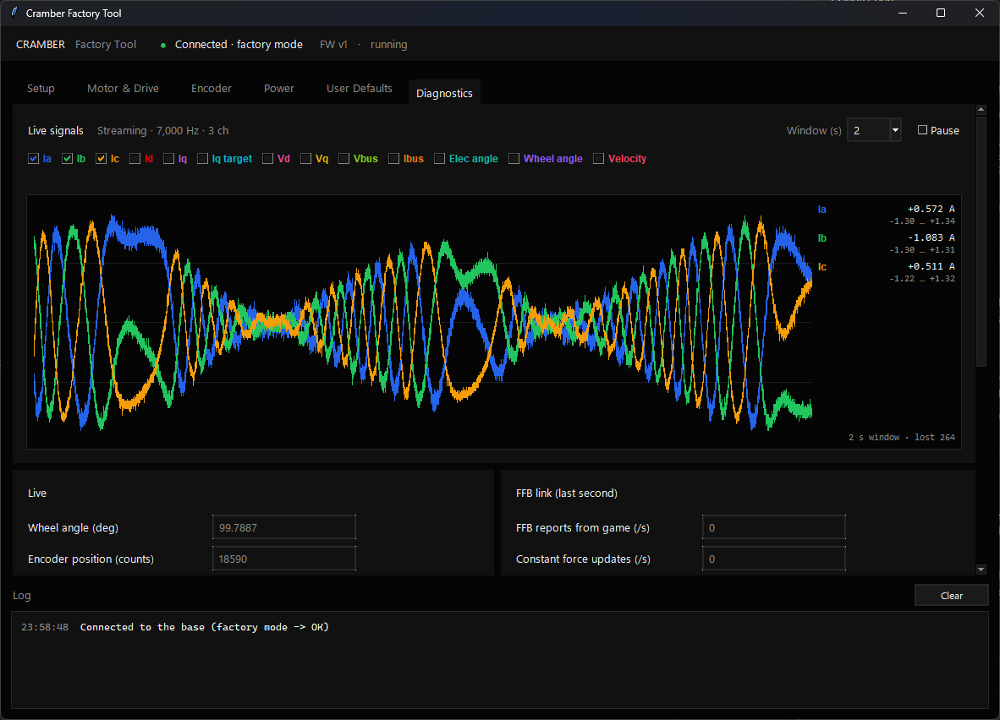

<div align="center">


# Cramber DD Factory Tool

**Calibration and diagnostics for the Cramber DD wheel base**

Guided calibration · Factory parameters · Live signals

[](LICENSE)
[](#getting-started)
[](https://www.python.org/)

[Getting started](#getting-started) · [Wheel base firmware](https://github.com/cramber-racing/cramber-basewheel) · [Cramber Hub](https://github.com/cramber-racing/cramber-hub)

</div>

<br>

<p align="center">
    
</p>

<br>

The factory tool prepares each Cramber DD for use. It calibrates the motor and the encoder, sets the factory
parameters and saves them on the base. It's also the bench tool for firmware development, with a live plot
of the motor's signals and diagnostics of the force feedback link.

> [!WARNING]
> This tool is meant for building and developing the base. Wrong factory parameters can damage the motor or
> the controller board.

## Ecosystem

| Project | Description |
| --- | --- |
| **[cramber-basewheel](https://github.com/cramber-racing/cramber-basewheel)** | Firmware that runs on the wheel base |
| **[cramber-hub](https://github.com/cramber-racing/cramber-hub)** | Desktop app to adjust force feedback and manage profiles |
| **[cramber-basewheel-factory](https://github.com/cramber-racing/cramber-basewheel-factory)** | Calibration and diagnostics tool used when building a base *(this repository)* |

## Features

<table>
<tr>
<td valign="top" width="50%">

**Guided setup**
- Every calibration step in order, with its status
- The reason reported by the base when a step fails
- Saves everything to the base and restarts it

**Factory parameters**
- Motor and drive, encoder, power and user defaults
- Apply or revert each tab
- Unsaved changes highlighted

</td>
<td valign="top" width="50%">

**Live signals**
- Real time plot of up to 8 signals at once
- Currents, voltages, angles and velocity
- Runs only while the Diagnostics tab is open

**Diagnostics**
- Motor driver status
- Last failure reason of each calibration
- Force feedback link: how many updates per second the game sends

</td>
</tr>
</table>

## Calibration steps

| Step | What it does |
| --- | --- |
| **Motor** | Measures the motor's phase resistance and inductance |
| **Find index** | Turns the motor until the encoder's index is found |
| **Encoder** | Aligns the encoder with the motor (one slow revolution) |
| **Center** | Sets the current wheel position as the center |
| **Anticogging** | Measures the motor's cogging to compensate for it |
| **Save** | Writes everything to the base and restarts it |

<details>
<summary>Signals available in the live plot</summary>

<br>

| Signal | Unit |
| --- | --- |
| Ia, Ib, Ic (phase currents) | A |
| Id, Iq, Iq target | A |
| Vd, Vq | V |
| Bus voltage | V |
| Bus current | A |
| Electrical angle | rad |
| Wheel angle | deg |
| Velocity | rad/s |

</details>

## Getting started

### 1. Install the tools

- [uv](https://docs.astral.sh/uv/getting-started/installation/), the Python package manager. It installs the
  right Python version and the dependencies by itself.

### 2. Run

Clone the repository and start the tool from its folder:

```sh
uv run main.py
```

### 3. Connect the base

Plug in a Cramber DD running the `release` firmware build. The tool connects automatically and switches the
base into factory mode.

### 4. Calibrate

Follow the **Setup** tab from top to bottom. When every step is done, click **Save & reboot**.

## License

Licensed under the [GPL-3.0](LICENSE). Third party libraries keep their own licenses.
